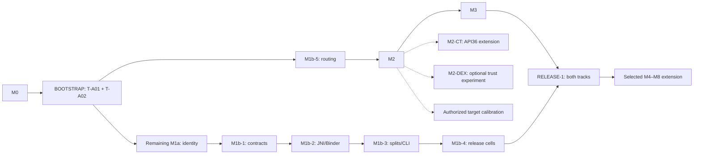

# repacking-lovers — build plan

Build a toolkit for authorized mobile security testing on a non-rooted Android device. Repackage
an APK to trust an embedded interception CA, remove tested Java pinning, and handle supported
app-local signing checks. Original-byte integrity handling and native stacks are later extensions.

**Start at [the execution index](docs/implementation/README.md).** This file owns shared rules,
scope, defaults, reporting and fallback policy. Milestone guides own numbered work instructions.
[Architecture](docs/ARCHITECTURE.md) preserves technical detail and rationale. M0 implementation and observations are recorded in progress.md; later commands remain work orders
until implemented and accepted by their gates.

Implementation follow-up: the user-authorized
[additional APK pinning adaptations](docs/pinning-expansion.md) extend the original
native/Java scope with Chromium/Cronet, hostname, offline ARM64 TLS and typed Dart
modes. Their explicit options, prerequisites and separate runtime evidence live
in that guide; the original milestone instructions below retain their historical
scope.

User-facing release instructions live in [README](README.md), operational details
in the [technical guide](docs/technical-guide.md), and remaining implementation,
compatibility tests and deferred options in [future work](docs/FUTURE-WORK.md).

## 1. Shared execution rules

Reference these IDs rather than writing slightly different copies of the same rule.

| ID | Rule |
|---|---|
| R-SCOPE | Test operator-owned fixtures or explicitly authorized in-scope targets; surface the scope in run output. |
| R-DEVICE | No root, VPN, persistent device-wide CA/proxy changes, or device-wide hidden-API policy changes. Identity diagnostics in M1a use ordinary access before the process-local trial. A uses one pinned, recorded process-local AndroidHiddenApiBypass implementation; ordinary access is diagnostic, not a second supported identity mode. Bootstrap/interception do not acquire an A dependency. Reverse listeners are device-local, not app-restricted; track ownership and remove only mappings created by the run. |
| R-INSTALL | Select a serial; validate package, signer, version, complete APK set and compatibility before installing. Never uninstall an existing app without explicit replacement/data-loss authorization. The public flag is `--replace-existing-and-wipe-data`. Retain original APKs; do not promise app-data recovery. |
| R-KEY | Use a persistent operator test key. Original, unrelated-fixture and repack identities must differ. Never generate a new repack key per run or expose secrets in logs. |
| R-INPUT | Start from immutable original members; hash inputs/outputs; exclude helpers from rewriting; reject previously patched inputs rather than double-patching. |
| R-EVIDENCE | Accept a gate only with its specified observations and controls on the recorded OS/target-SDK/ABI/process cell. Untested cells have no coverage claim. A build, tool exit or init log alone is insufficient. |
| R-FAILURE | Use §7's statuses. Missing prerequisites are not patch failures. Requested transforms that cannot finish return nonzero with a partial/failed report. Never silently drop a transform or change modes. |
| R-ORDER | Implement one eligible work packet at a time, respecting §5's dependencies. BOOTSTRAP opens interception independently of identity feasibility. Follow the interception-first schedule; do not build adapters, public flags or deferred modules ahead of their gate. |
| R-EXPERIMENT | Unresolved behavior gets one named experiment, evidence and a failure branch. Do not replace uncertainty with a guarantee or implement every candidate simultaneously. |

## 2. Scope and hard limits

| ID | Mechanism | Claim permitted after its gate |
|---|---|---|
| S-TRUST | Embedded NSC test anchor | Tested configurations on NSC-aware stacks; M2. |
| S-JAVA | Java pinning patches | Tested descriptors and optimized builds; M3. |
| S-A | Process-local package-manager proxy | Tested methods, cache/acquisition paths, signing semantics and processes; M1a/M1b. |
| S-B | Original-byte file reads | Named paths passing integrity and patched runtime-loading tests; M4, opt-in. |
| S-NATIVE | Known native TLS libraries | Exact tested builds and ABIs; M6. |
| S-WEBVIEW | WebView routing | Separate optional routing fixture/module; Java ProxySelector coverage does not establish WebView routing. Use feature-gated AndroidX ProxyController and wait for its completion callback before the request. |
| L-EXTERNAL | OS signing permissions/shared UID, GMS/another unmodified process, certificate-bound OAuth/API registrations | A cannot change the actual installed identity observed outside its process. Login/integrations may fail. In-process Firebase headers need a construction-path fixture. |
| L-ATTESTATION | Keystore key attestation checked by a server | AttestationApplicationId includes real signing-certificate digests; process-local A cannot substitute the installed identity in that externally verified extension. |
| L-PACKED | Encrypted/packed DEX | Static decoding may yield only a loader; dynamic unpacking is outside this workflow. |
| L-RASP | Commercial anti-hook/native self-integrity | Per-target analysis may be required. Injected DEX, proxies and libraries remain detectable. |
| L-PAIRIP | PairIP indicators / Play automatic protection | Release 1 does not remove this protection. P0 records Lcom/pairip/ descriptors (com.pairip.* names) and libpairipcore.so markers; markers indicate a candidate, not proven enforcement. Installer preservation or A does not establish that Play installer/license, anti-tamper or device checks will pass. |
| L-INTEGRITY | Server-enforced Play Integrity | A repack cannot manufacture Google's original-identity verdict or satisfy a backend requiring original `certificateSha256Digest`/`PLAY_RECOGNIZED`. |

**L-INTEGRITY evidence:** assess `deviceIntegrity` and `appIntegrity` independently; stock hardware
is not a verdict guarantee. API references establish presence only. A generic backend rejection
does not establish enforcement; require evidence such as a controlled backend log or documented
integrity-specific response. Successful traffic proves only its tested flow. Apply this evidence
rule to legacy SafetyNet references too. Enforcement status is defined once in §7.

## 3. Approved defaults

| Decision | Default | Change trigger |
|---|---|---|
| First test cell | Connected authorized physical phone first; currently API30/ARM64/4096-byte pages, fixture target35/min28 | Source the operator ADB configuration before discovery. Existing emulator is fallback; check acceleration before any new image download. |
| Fixture tools | Installed JDK27, javac --release 8, build-tools36.0.0, compileSdk36 public android.jar; aapt2/d8/zipalign/apksigner | Pin working versions/hashes; use primitive release builds, with standalone R8 later for M3. |
| Shim | Java/javac/d8 against public android.jar; hidden types through Class.forName/reflection with descriptors centralized in Hidden.java | No hidden platform imports or packaged framework stubs. Vendor build-only stubs stay outside shipped DEX. |
| Bootstrap trial | Append our RepackFactory/shim DEX, edit binary manifest factory attribute, delegate by composition to the original | T-A01 tests own/final/AndroidX/custom-loader factories. Shadow bootstrap is a separately accepted --dex-only strategy. |
| DEX packaging | Bootstrap appends helper DEX contiguously without renaming originals | Shadowing is reserved for --dex-only bootstrap and M3 class patches; check selection and original payload hashes per strategy. |
| API-35 first swap | Publish ActivityThread.sPackageManager before any shim self-getPackageInfo call; inspect known contexts without creating a manager | Patch observed pre-existing managers' mPM only if present; cache-hit controls remain required. |
| Hidden access for A | Pin/vendor AndroidHiddenApiBypass and required helpers under Apache-2.0; initialize before A's hidden access in initEarly | Use process-local prefix ["L"]; ordinary T-A06 remains diagnostic. Required functional failure stops A and follows §8; no second ordinary-access release matrix. |
| Signing metadata | Export owned fixture cert DER with keytool and match host apksigner digests; measure original-archive parsing and public CREATOR serialization before hidden constructors | A selected API28–34 cell activates M1b-1's T-A16 adapter task, including a bounded hidden SigningDetails/SigningInfo construction branch when early archive metadata is unavailable. |
| Network | Install routing in initLate; baked endpoint defaults to 127.0.0.1:8080, configurable with patch --proxy; adb reverse is the reference transport | Covered HTTP(S) selector choices contain only the proxy; no DIRECT fallback. T-N12 proves proxy-down failure/no origin hit for tested clients, with optional wireless-adb and remote-endpoint transport cells. |
| Resource engine | Apktool first; early bounded corpus tests before broad trust claims | After a concrete engine failure, trial one pinned APKEditor/ARSCLib implementation against identical insertion/runtime fixtures; a no-op rebuild alone is insufficient. |
| Native hook, later | ByteHook as the first M4 trial, pin revision when M4 opens | T-B00 proves a required import/API/ABI/loader failure attributable to the library; then compare one alternative. |

These choices do not assert installed dependencies or passing tests. M0 records resolved versions,
hashes and the image build. The selected phone API is the first experiment, not the entire release range. Physical
ARM, production-like images, other API/target pairs and 16 KB native environments need later evidence.

## 4. Pipeline ownership

```text
P0 Recon → P1 Trust → P2 Java unpin → P3 Signing/integrity → P4 Build/sign → P5 Verify
```

`patch` ends at P4. Device actions belong to `verify`.

| Phase | Responsibilities | Instructions |
|---|---|---|
| P0 | Selected-set validation/dependencies, fingerprint confidence, original bytes/signers/history, installer evidence, hashes | M0 baseline, then M1b-1/M1b-3. |
| P1 | Preserve NSC policy; embed anchor with `overridePins="true"`; compile/link resources | [M2](docs/implementation/M2-M3.md#m2--trust-configuration). |
| P2 | Multi-signal Java patches with exact return contracts | [M3](docs/implementation/M2-M3.md#m3--java-pinning). |
| P3 | A contracts/cache paths; B separately gated | [M1a](docs/implementation/M1a.md), [M1b](docs/implementation/M1b.md), [M4](docs/implementation/LATER.md#m4--original-byte-read-experiments). |
| P4 | DEX-only/resource build, reference/native constraints, align/sign/verify every member | [Build reference](docs/ARCHITECTURE.md#build-and-sign). |
| P5 | Preflight, per-process capability evidence, fixture actions/controls, actual device state | Active task plus [acceptance contract](docs/implementation/CONTRACT.md). |

## 5. Gate dependencies and default schedule



| Gate | Prerequisite | Outcome / guide |
|---|---|---|
| M0 | None | Git/tools/cell, primitive fixture build and T-A00 baseline — [M0](docs/implementation/M0.md) |
| BOOTSTRAP | M0; T-A01 and T-A02 passed | M1a tasks 1–2: early/late hooks, signed round-trip, minimal preflight — [M1a](docs/implementation/M1a.md) |
| M1a | BOOTSTRAP; identity tasks 3–6 | First A path using the pinned process-local mode, plus metadata experiment — [M1a](docs/implementation/M1a.md) |
| M1b-5 | BOOTSTRAP | Interception: routing/persistence, no identity requirement — [routing](docs/implementation/M1b.md#m1b-5--routing-and-persistence) |
| M2, M3 | M1b-5, then M2 | Interception track: HTTPS proof, then Java pinning — [M2/M3](docs/implementation/M2-M3.md) |
| M2-CT | M2, available API36 cell | T-T22; required for API36 CT claims, not M2/M3 on API35. |
| M2-DEX | M2, pinned hidden access for this experiment | T-T23; independent DEX-only trust experiment, not an automatic replacement for resource trust or a requirement of M3/RELEASE-1. |
| M1b-1 | M1a | Identity track: signing/installer/cache contracts — [contracts](docs/implementation/M1b.md#m1b-1--signing-contracts-and-caches) |
| Legacy metadata subpacket | Recorded API28–34 first/release cell and successful M1a task 3 access | M1b-1 task 3 / T-A16 may run before full M1a when required to unblock its first selected-cell signing path. The full M1b-1 gate still needs M1a and T-A10/T-A11. |
| M1b-2 | M1b-1 | Identity track: JNI-to-Java/fresh stubs — [JNI/Binder](docs/implementation/M1b.md#m1b-2--jni-and-fresh-java-binder-stubs) |
| M1b-3 | M1b-2 | Identity track: selected splits, artifacts/schema/public CLI — [integration](docs/implementation/M1b.md#m1b-3--split-sets-and-install-integration) |
| M1b-4 | M1b-3 | Identity track: startup/processes and release cells — [matrix](docs/implementation/M1b.md#m1b-4--process-and-startup-coverage) |
| RELEASE-1 | M3 and M1b-4 | Join both tracks; validate all claimed release capabilities on their declared cells. |
| M4–M8 | RELEASE-1 plus extension prerequisites | [Deferred guide](docs/implementation/LATER.md) |

Default schedule: M0 → BOOTSTRAP → M1b-5 → M2 → M3 → remaining M1a → M1b-1 → M1b-2 → M1b-3 → M1b-4 → RELEASE-1.
If an eligible track is blocked, work may continue on the other without accepting the blocked gate.
Tracks reuse the bootstrap packet's immutable inputs, case reports and fixture install preflight; they
do not wait for the full public schema/CLI. No JNI, splits or physical ARM device is needed for the
first controlled HTTPS proof. RELEASE-1 reruns signing plus interception on each claimed release
cell, including physical ARM coverage. An identity failure follows its bounded access/fallback
branch without invalidating accepted trust-only/interception evidence. CT and real-target
calibration run when eligible and do not block the first selected-cell HTTPS proof. M2-DEX is optional
after M2 and does not interrupt the default schedule. If an API28–34 phone is the only selected execution
cell, use the named metadata subpacket before M1a task 4 rather than creating a circular gate
dependency or calling API35 constructors on that phone. B stays optional.

## 6. Public CLI boundary

M0/M1a use fixture scripts. At M1b-3 expose only these commands and flags; reject unimplemented
operations instead of adding placeholder success paths:

```text
repack triage <input> [--device <serial> | --device-spec <json>]
repack patch <input> --out <path> --key <keystore>
             [--antitamper] [--dex-only] [--trust-only] [--ca <pem>] [--proxy host:port]
             [--device <serial> | --device-spec <json>]
repack verify <artifact-manifest> --device <serial> [--proxy host:port]
              [--replace-existing-and-wipe-data]
```

Input initially means one APK, a validated directory of already selected splits, or `pkg:<name>`
with a serial. Single APK output has a sidecar manifest; sets have a directory manifest binding
member hashes. `verify` checks these hashes before use. `--trust-only` and `--dex-only` conflict.
Trust transforms open in M2 via fixture scripts even if public CLI integration has not happened;
at M1b-3 expose the implementations already accepted. Trust requires a public CA matching the
proxy. Full interception includes the configured route. `patch --proxy` bakes the endpoint into
the artifact; default `127.0.0.1:8080`. Accept a hostname, IPv4 or bracketed IPv6 address plus a
port in 1–65535; reject schemes, paths, credentials and malformed/ambiguous input before building.
Store normalized host/port in the artifact manifest; generate Java configuration without source
interpolation. This option first exists on the M1b-5 internal spike and becomes public at M1b-3.
It does not select a device-wide transport. `--trust-only` changes trust alone and rejects
`--proxy`; `--dex-only` may configure routing without a resource rebuild.
The ordinary combined patch supplies routing plus selected trust/Java transforms. `verify --proxy`
asserts the artifact's configured endpoint and cannot silently override it.

`--antitamper` explicitly enables only accepted process-local A methods/acquisition paths from
M1a/M1b-1 (and later separately accepted additions). It remains opt-in for the initial release.
Fixture acceptance alone does not justify enabling visible runtime hooks on every target by
default. Do not add --no-antitamper until a measured compatibility decision changes that default.
P0 reports signing-API references as advisory triage evidence with locations and confidence;
neither their presence nor absence automatically enables/disables A. Record the explicit request
and resulting decision. Scan the `PackageInfo.signingInfo` field, not an assumed platform
getSigningInfo getter. Reference constants alone are insufficient to identify a self-check.

User-store trust, static anti-tamper, target lowering, installer override, transport switches,
Measured extension flags are `--native-tls reflutter-3.10.6-arm64` and `--gadget raw-apk-fixture`, each explicit and scoped by its accepted guide/evidence. M5 adds targeted containers. M8 adds read-only `verify --runtime-evidence packet.json [--review review.md]`; it conflicts with replacement authorization. Side-by-side package renaming remains deferred.

M4 adds the explicit `--integrity native-base-bytes:libCaller.so[,libOther.so]` extension.
It requires `--device`, an existing tested API30 ARM ABI and one or two unambiguous app native
libraries with supported file-opening imports. It maps absolute read-only base-APK opens only
in those callers. The original is verified/provisioned from the signed artifact before original
factory construction. Split-original reads remain experimental; proc-fd paths, raw syscalls,
dlsym pointers, preopened descriptors and mixed integrity/runtime reads in the same selected
caller remain gaps. It conflicts with `--trust-only`. Build status remains separate from actual
runtime publication and observed reads. M4 acceptance requires the public T-B04 packet as well
as the import/read/coexistence/ABI experiments and default identity/HTTPS regressions.
Historical CLI sketches are not permission to implement those options early.

## 7. Canonical results and acceptance record

Use these enums once across modules:

- Transformation: `applied`, `skipped`, `unsupported`, `failed`.
- Verification: `passed`, `failed`, `inconclusive`, `not-run`.
- Enforcement: `unknown`, `suspected`, `confirmed`, with evidence reference.
- Gate progress: `planned`, `in-progress`, `accepted`, `blocked` (project task state, not a target verdict).

Evidence JSON records schema version, run/case ID, OS build/API, target/min SDK, ABI/page size,
process/PID, input/output hashes, signing fingerprints, command argv/exit status, expected/observed
comparisons, artifact/log references, prerequisites and device mutations/cleanup. Use explicit
null/not-run fields when unavailable. Separate timestamps/run IDs from semantic diffable fields.

M0/M1a and the early interception track serialize observed subsets with standard-library JSON.
M1b-3 freezes the public schema. [CONTRACT.md](docs/implementation/CONTRACT.md) owns command/evidence
behavior and minimal valid examples. Update [progress.md](docs/implementation/progress.md) during
implementation to link accepted gates to actual evidence. Expected output is not an observed result.

## 8. Fallback policy

Record the smallest failed experiment first. Resolve required access/forwarding failures within
the pinned process-local A mode before escalating; ordinary diagnostic failure alone does not
trigger a fallback. A bounded in-house PackageInfo.CREATOR/parcel-cache
experiment may follow a failed A implementation, before adopting external frameworks. Give it a
separate mode and the same identity/control oracle: it does not cover signing-check Binder methods,
needs its own cache/field-access tests, and is not a guaranteed cheap substitute. No other track
depends on that experiment's success. If our implementation cannot meet the required path,
look for a maintained alternative and test it against the same requirements. If none is suitable
and our approach remains infeasible, **archived LSPatch remains a practical fallback to test**.
Its deprecated/archived status does not automatically disqualify it.

Pin its revision/build and dependencies; record license, footprint, support cell, failures and
report mode. Keep fallback results distinct from own-tool success. No maintained successor or
compatibility is assumed. If it fails too, record the limitation and revised scope. Never silently
substitute static rewriting or an archived framework for the requested method.

## 9. Technical sources

Use source contracts and pin release/dependency revisions in evidence:

- [d8](https://developer.android.com/tools/d8), [apksigner](https://developer.android.com/tools/apksigner), [Apktool](https://apktool.org/docs/cli-parameters/).
- [PackageManager](https://developer.android.com/reference/android/content/pm/PackageManager), [SigningInfo](https://developer.android.com/reference/android/content/pm/SigningInfo), [InstallSourceInfo](https://developer.android.com/reference/android/content/pm/InstallSourceInfo).
- [Non-SDK restrictions and flag files](https://developer.android.com/guide/app-compatibility/restrictions-non-sdk-interfaces), [VMRuntime meta-reflection flag](https://android.googlesource.com/platform/prebuilts/fullsdk/sources/+/refs/heads/androidx-leanback-release/android-35/dalvik/system/VMRuntime.java), [AndroidHiddenApiBypass](https://github.com/LSPosed/AndroidHiddenApiBypass).
- [ActivityThread](https://android.googlesource.com/platform/frameworks/base/+/refs/heads/main/core/java/android/app/ActivityThread.java), [ContextImpl](https://android.googlesource.com/platform/frameworks/base/+/refs/heads/main/core/java/android/app/ContextImpl.java), [ServiceManager](https://android.googlesource.com/platform/frameworks/base/+/refs/heads/main/core/java/android/os/ServiceManager.java), [LoadedApk](https://android.googlesource.com/platform/frameworks/base/+/refs/heads/main/core/java/android/app/LoadedApk.java).
- [Bionic opens](https://android.googlesource.com/platform/bionic/+/refs/heads/main/libc/bionic/open.cpp), [Proxy](https://android.googlesource.com/platform/frameworks/base/+/refs/heads/main/core/java/android/net/Proxy.java), [process model](https://developer.android.com/guide/components/processes-and-threads).
- [NSC/CT](https://developer.android.com/privacy-and-security/security-config), [Play Integrity](https://developer.android.com/google/play/integrity/verdicts), [OAuth identity](https://android-developers.googleblog.com/2016/03/registering-oauth-clients-for-google.html).
- [Key-attestation application identity](https://source.android.com/docs/security/features/keystore/attestation#attestationapplicationid), [WebView ProxyController](https://developer.android.com/reference/androidx/webkit/ProxyController), [avdmanager documentation](https://developer.android.com/tools/avdmanager).
- API-35 pinned call paths: [PackageManager](https://android.googlesource.com/platform/frameworks/base/+/refs/tags/android-15.0.0_r1/core/java/android/content/pm/PackageManager.java), [ApplicationPackageManager](https://android.googlesource.com/platform/frameworks/base/+/refs/tags/android-15.0.0_r1/core/java/android/app/ApplicationPackageManager.java), [ContextImpl](https://android.googlesource.com/platform/frameworks/base/+/refs/tags/android-15.0.0_r1/core/java/android/app/ContextImpl.java).
- [CoreComponentFactory source](https://android.googlesource.com/platform/frameworks/support/+/refs/heads/androidx-main/core/core/src/main/java/androidx/core/app/CoreComponentFactory.java), [Field.set contract](https://developer.android.com/reference/java/lang/reflect/Field#set(java.lang.Object,%20java.lang.Object)).
- [ApkSignatureKillerEx implementation](https://github.com/L-JINBIN/ApkSignatureKillerEx/blob/main/killer/src/main/java/bin/mt/signature/KillerApplication.java): PackageInfo.CREATOR/parcel-cache prior art, not proof of IPackageManager dynamic-proxy generation.
- [DEX format](https://source.android.com/docs/core/runtime/dex-format), [bytecode](https://source.android.com/docs/core/runtime/dalvik-bytecode), [R8](https://developer.android.com/topic/performance/app-optimization/enable-app-optimization), [16 KB support](https://developer.android.com/guide/practices/page-sizes).
- [adb reverse](https://developer.android.com/develop/ui/views/layout/webapps/access-local-server), [AVD images](https://developer.android.com/studio/run/managing-avds), [bundletool](https://developer.android.com/tools/bundletool).
- [LSPatch](https://github.com/LSPosed/LSPatch): historical design/issue evidence and conditional fallback under §8. Evaluate forks independently.
- [API35 ART reflection-caller logic](https://android.googlesource.com/platform/art/+/refs/tags/android-15.0.0_r1/runtime/hidden_api.cc), [Proxy generation](https://android.googlesource.com/platform/libcore/+/refs/tags/android-15.0.0_r1/ojluni/src/main/java/java/lang/reflect/Proxy.java), [startup proxy setup](https://android.googlesource.com/platform/frameworks/base/+/refs/tags/android-15.0.0_r1/core/java/android/app/ActivityThread.java).
- [Google smali](https://github.com/google/smali), [zipalign](https://developer.android.com/tools/zipalign), [target-30 packaging](https://developer.android.com/about/versions/11/behavior-changes-11#app-packaging), [mitmproxy CA files](https://docs.mitmproxy.org/stable/concepts/certificates/).
- [API35 ART class lookup](https://android.googlesource.com/platform/art/+/refs/tags/android-15.0.0_r1/runtime/native/dalvik_system_DexFile.cc), [consecutive DEX loading](https://android.googlesource.com/platform/art/+/refs/tags/android-15.0.0_r1/libdexfile/dex/dex_file_loader.cc): source basis for the shadowing trial, not a universal class-loader guarantee.
- [AndroidHiddenApiBypass license](https://github.com/LSPosed/AndroidHiddenApiBypass/blob/main/LICENSE), [APKEditor](https://github.com/REAndroid/APKEditor), [ARSCLib](https://github.com/REAndroid/ARSCLib), [adb install options](https://developer.android.com/tools/adb).
- [Factory API levels](https://developer.android.com/reference/android/app/AppComponentFactory#instantiateClassLoader(java.lang.ClassLoader,%20android.content.pm.ApplicationInfo)), [Play automatic protection](https://support.google.com/googleplay/android-developer/answer/10183279), [wireless adb](https://developer.android.com/tools/adb#connect-to-a-device-over-wi-fi).
- API35 trust experiment: [ApplicationConfig](https://android.googlesource.com/platform/frameworks/base/+/refs/tags/android-15.0.0_r1/core/java/android/security/net/config/ApplicationConfig.java), [provider installation](https://android.googlesource.com/platform/frameworks/base/+/refs/tags/android-15.0.0_r1/core/java/android/security/net/config/NetworkSecurityConfigProvider.java), [NetworkSecurityConfig](https://android.googlesource.com/platform/frameworks/base/+/refs/tags/android-15.0.0_r1/core/java/android/security/net/config/NetworkSecurityConfig.java), [trust-manager factory](https://android.googlesource.com/platform/frameworks/base/+/refs/tags/android-15.0.0_r1/core/java/android/security/net/config/RootTrustManagerFactorySpi.java).
- [API34 SigningDetails](https://android.googlesource.com/platform/frameworks/base/+/refs/tags/android-14.0.0_r1/core/java/android/content/pm/SigningDetails.java), [API34 SigningInfo](https://android.googlesource.com/platform/frameworks/base/+/refs/tags/android-14.0.0_r1/core/java/android/content/pm/SigningInfo.java), [OkHttp 4.12 route selection](https://github.com/square/okhttp/blob/parent-4.12.0/okhttp/src/main/kotlin/okhttp3/internal/connection/RouteSelector.kt).
- [ConfigSource](https://android.googlesource.com/platform/frameworks/base/+/refs/tags/android-15.0.0_r1/core/java/android/security/net/config/ConfigSource.java), [KeyStoreCertificateSource](https://android.googlesource.com/platform/frameworks/base/+/refs/tags/android-15.0.0_r1/core/java/android/security/net/config/KeyStoreCertificateSource.java), [retained policy binding](https://android.googlesource.com/platform/frameworks/base/+/refs/tags/android-15.0.0_r1/core/java/android/security/net/config/ConfigNetworkSecurityPolicy.java).
